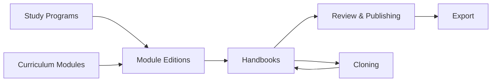

# Overview

The handbook is an **catalog**: which modules a study program offers in a given term (with posibility of grouping into sections) with one description per module and term. 

Possible sequential actions after defining catalog is: exporting as Latex, Typs

Model:

1. Study Programs and Curriculum Modules ([Catalog](02-catalog.md))
2. Per‑term descriptions of modules ([Module Editions](03-module-editions.md))
3. Handbook assembly: sections and ordered entries ([Handbooks](04-handbooks.md))

Possible actions in Modulehandbook: (see [End-to-End Workflow](07-end-to-end-workflow.md) #TODO)

4. Create master data: Study Programs and Curriculum Modules
5. Create Modulehandbook
6. PDF export, filtered by status ([Export](06-export.md))
7. Next term / or targeted term: clone a handbook into the new term ([Cloning](05-cloning.md))

Other concerns:

8. Access control ([Roles & Permissions](08-roles-and-permissions.md))
9. Integrity checks ([Integrity & Invariants](09-integrity-and-invariants.md))
10. Roadmap & extensibility ([Future Extensions](10-future-extensions.md))

## Design Tenets

* MaMpf already has `Course`, `Lecture` and `Term`. 
    * A MaMpf `Course` and `Lecture` is created by teachers for teaching and is not verified by the admin. The handbook needs its own verified records, so it introduces `CurriculumModule` and `ModuleEdition`
    * only **reuses `Term`**. 
    * An optional link from a module edition to a MaMpf `Lecture` is a future extension.

- A module's description for a term lives in `Handbook::ModuleEdition`; handbooks only reference it.
- Stable and term‑specific: 
    * what never changes between terms (code, names) lives on `Handbook::CurriculumModule`
    * everything else lives on `Handbook::ModuleEdition`.
- A `Handbook` reaches `ModuleEdition` memberships exclusively via `Section` then its `SectionEntry`
- Copies record `cloned_from` instead of overwriting history, should use transactional bulk operations (`CloneService#call` uses find‑or‑create and runs in one transaction), (and Idempotent?? #TODO)
- Export format is a template choice, not a data concern.
