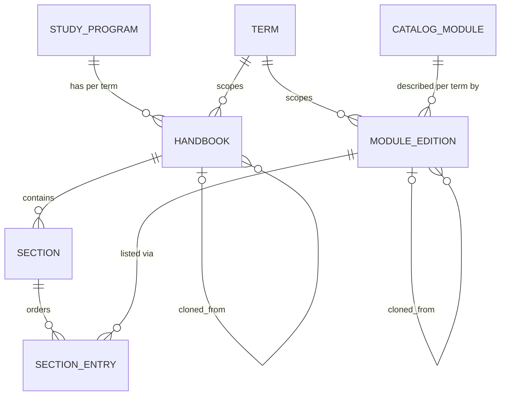

# Domain Model

This chapter summarizes principal entities; authoritative behavioral details live in the referenced chapters.

```admonish warning "Why not `Module`?"
`Module` is a core Ruby constant. A model called `Module` (or `Handbook::Module`, which shadows it inside the namespace) breaks constant lookup in subtle ways. The stable catalog entry is therefore named `Handbook::CurriculumModule`.
```

## Catalog

| Component | Type | Description |
|-----------|------|-------------|
| Handbook::StudyProgram | ActiveRecord | A degree program variant (e.g., Mathematik, Bachelor 100%) |
| Handbook::CurriculumModule | ActiveRecord | Admin‑verified, term‑independent module: code, name DE/EN |
| Term | ActiveRecord (MaMpf, reused) | Semester (e.g., WS 2026/27) |

## Module Editions

| Component | Type | Description |
|-----------|------|-------------|
| Handbook::ModuleEdition | ActiveRecord | One catalog module in one term: content, language, ECTS, status (created/checked/published) |
| Handbook::EditionCopier | Service | Builds a new edition from an existing one (content copy, status reset, lineage) |

## Handbooks

| Component | Type | Description |
|-----------|------|-------------|
| Handbook::Handbook | ActiveRecord | One study program in one term; container for sections; status (draft/published) |
| Handbook::Section | ActiveRecord | Ordered, titled group inside one handbook |
| Handbook::SectionEntry | ActiveRecord | Ordered link (section, module edition) |

## Cloning & Export

| Component | Type | Description |
|-----------|------|-------------|
| Handbook::CloneService | Service | Copies a handbook into a target term; find‑or‑create editions |
| Handbook::Exporter | Service | Renders a handbook (status‑filtered) via pandoc + template to LaTeX/Typst/Markdown/PDF |
| HandbookAbility | Ability (CanCanCan) | Viewer vs. admin permissions |

## Linking Concepts

```admonish info "What are linking concepts?"
These are the points where the handbook touches existing MaMpf models. The handbook is deliberately loosely coupled: it reuses `Term` and `User`, and nothing else.
```

| Domain Model | Links To | Via | Purpose |
|--------------|----------|-----|---------|
| Term | Module Editions | `belongs_to :term` | Scope an edition to a semester |
| Term | Handbooks | `belongs_to :term` | Scope a handbook to a semester |
| User | Permissions | `HandbookAbility` | Viewer vs. admin |
| Lecture | Module Editions | none (future, optional) | Link an edition to the lecture that teaches it |

**Example Flows:**

1. **Build a handbook:** `StudyProgram` + `Term` → `Handbook::Handbook` → `Handbook::Section`s → `Handbook::SectionEntry` linking a `Handbook::ModuleEdition` (found or created for `CurriculumModule` + `Term`)
2. **Review:** `ModuleEdition` created → checked → published; editing content resets to created
3. **Next term:** `Handbook::CloneService` copies `Handbook` + `Section`s, finds or creates `ModuleEdition`s in the target term, rebuilds `SectionEntry`s via an id map
4. **Export:** `Handbook::Exporter` walks sections → entries → editions in order, filters by status, renders Markdown content through pandoc into a template

## High-Level ERD (Simplified)



```admonish note "One edition, many handbooks"
A `ModuleEdition` is shared by every handbook of its term that lists it (e.g., Bachelor 100% and Master 100% both list *Lineare Algebra I, WS 2026/27*). Editing it changes all of them. This is intended and is the reason cloning uses find‑or‑create (see [Cloning](05-cloning.md)).
```

See details:

- [Catalog](02-catalog.md)
- [Module Editions](03-module-editions.md)
- [Handbooks](04-handbooks.md)
- [Cloning](05-cloning.md)
- [Export](06-export.md)
- [Integrity & Invariants](09-integrity-and-invariants.md)
