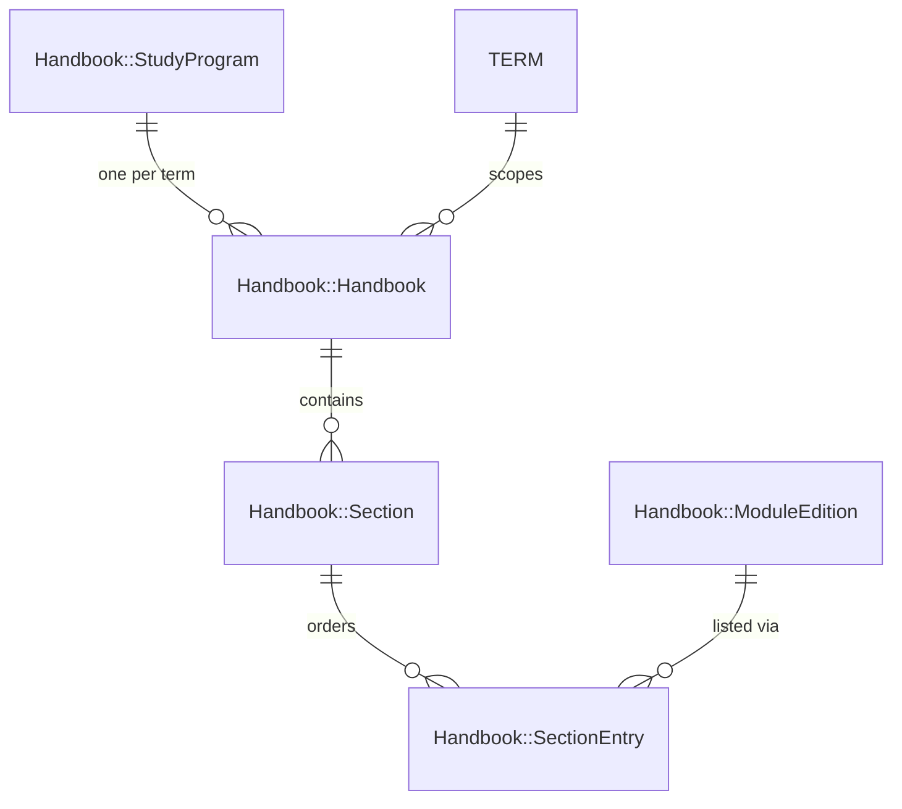

# Handbooks

```admonish question "What is a 'Handbook'?"
A handbook is the ordered list of modules a study program offers in a term.

- **Common Examples:** "Modulhandbuch Mathematik B.Sc. 100%, WS 2026/27"
- **In this context:** A container of ordered sections, each holding ordered references to module editions. It holds structure only, never module content.
```

## Problem Overview

- Each study program publishes its own handbook per term, grouped into sections (e.g., "Pflichtmodule", "Wahlpflichtmodule").
- The same module edition can sit in several handbooks of the same term.
- A module offered for program K in term X may be missing for K in term Y; this must be expressible without flags on the module.

## Solution Architecture

- **Handbook = (study program, term)**, unique.
- **Sections belong to exactly one handbook**; reuse across handbooks is not worth the coupling.
- **Membership only through `SectionEntry`**: no direct handbook ↔ edition link, so there is one source of truth. "Module belongs to K in X but not in Y" falls out of which entries exist.
- **Ordering via `position`** (`acts_as_list`) on sections and entries.

```admonish tip "Glossary (Handbooks)"
- **Handbook:** program + term + ordered sections.
- **Section:** titled group inside a handbook.
- **Entry:** one edition placed in a section at a position.
```

---

## Handbook::Handbook (ActiveRecord Model)
**_The Document_**

```admonish info "What it represents"
The module handbook of one study program for one term.
```

```admonish tip "Think of it as"
The table of contents of the printed PDF. Pages (editions) are shared with other handbooks of the same term.
```

| Name/Field | Type/Kind | Description |
|------------|-----------|-------------|
| `study_program_id` | DB column | Foreign key to `Handbook::StudyProgram` |
| `term_id` | DB column | Foreign key to MaMpf `Term` |
| `status` | DB column (Enum) | `draft`, `published` (visibility of the handbook itself) |
| `cloned_from_id` | DB column | Source handbook (nullable) |
| `sections` | Association | Ordered sections |
| `module_editions` | Association | All editions, through sections and entries |
| `status_counts` | Method | `{ created: n, checked: n, published: n }` over its editions |

### Behavior Highlights

- Unique on (`study_program_id`, `term_id`).
- Destroying a handbook destroys its sections and entries, **never** the editions.
- Handbook `status` and edition `status` are independent: publishing the handbook makes it visible to viewers; which editions are printed is decided by the export filter (see [Export](06-export.md)).

```admonish warning "Open question"
Does one handbook ever cover several programs (e.g., 100% and 50% together)? If yes, `study_program_id` becomes a join table `handbook_handbook_study_programs`; nothing else in this chapter changes.
```

### Example Implementation

```ruby
module Handbook
  class Handbook < ApplicationRecord
    belongs_to :study_program, class_name: "Handbook::StudyProgram"
    belongs_to :term
    belongs_to :cloned_from, class_name: "Handbook::Handbook", optional: true

    has_many :sections, -> { order(:position) },
             class_name: "Handbook::Section",
             dependent: :destroy
    has_many :section_entries, through: :sections
    has_many :module_editions, through: :section_entries

    enum status: { draft: 0, published: 1 }

    validates :study_program_id, uniqueness: { scope: :term_id }

    def status_counts
      module_editions.group(:status).count
    end
  end
end
```

---

## Handbook::Section (ActiveRecord Model)
**_A Chapter of the Handbook_**

```admonish info "What it represents"
A titled, ordered group of module editions inside one handbook.
```

```admonish tip "Think of it as"
A chapter heading in the PDF: "Pflichtmodule", "Wahlpflichtmodule Reine Mathematik".
```

| Name/Field | Type/Kind | Description |
|------------|-----------|-------------|
| `handbook_id` | DB column | Foreign key to the handbook |
| `title_de` | DB column | German title |
| `title_en` | DB column | English title (nullable) |
| `position` | DB column | Order within the handbook |
| `section_entries` | Association | Ordered entries |

### Example Implementation

```ruby
module Handbook
  class Section < ApplicationRecord
    belongs_to :handbook, class_name: "Handbook::Handbook"
    has_many :section_entries, -> { order(:position) },
             class_name: "Handbook::SectionEntry",
             dependent: :destroy
    has_many :module_editions, through: :section_entries

    acts_as_list scope: :handbook

    validates :title_de, presence: true
  end
end
```

```admonish note "Modules outside any section"
If some handbooks list modules without a heading, create a section with an empty title and render it without a heading. Do **not** add a direct handbook ↔ edition link.
```

---

## Handbook::SectionEntry (ActiveRecord Model)
**_A Module's Place in a Section_**

```admonish info "What it represents"
The placement of one module edition at a position in one section.
```

```admonish tip "Think of it as"
- **Library Analogy:** A reading list entry pointing at a book; many reading lists can point at the same book.
- **Comparison:** Plays the role `Registration::Item` plays for registerables: a listing, not the thing itself.
```

| Name/Field | Type/Kind | Description |
|------------|-----------|-------------|
| `section_id` | DB column | Foreign key to the section |
| `module_edition_id` | DB column | Foreign key to the edition |
| `position` | DB column | Order within the section |

### Behavior Highlights

- Unique on (`section_id`, `module_edition_id`).
- **Term guard:** the edition's term must equal the handbook's term.
- Removing an entry never deletes the edition.

### Example Implementation

```ruby
module Handbook
  class SectionEntry < ApplicationRecord
    belongs_to :section, class_name: "Handbook::Section"
    belongs_to :module_edition, class_name: "Handbook::ModuleEdition"

    acts_as_list scope: :section

    validates :module_edition_id, uniqueness: { scope: :section_id }
    validate :edition_term_matches_handbook

    private

    def edition_term_matches_handbook
      return if module_edition.nil? || section.nil?
      return if module_edition.term_id == section.handbook.term_id

      errors.add(:module_edition, "must belong to the handbook's term")
    end
  end
end
```

### Usage Scenarios

- **Add a module with an existing edition:** the admin searches *Lineare Algebra I*; an edition for the handbook's term exists (created by the Bachelor handbook), so an entry is created pointing at it.
- **Add a module without an edition:** no edition exists for this term; the UI offers "empty" or "copy from previous term" ([EditionCopier](03-module-editions.md#handbookeditioncopier-service-object)), then creates the entry.
- **Move a module:** the entry changes `section_id` and `position`; the edition is untouched.

---

## ERD



---

## Database Tables

- `handbook_handbooks` - One per (study program, term)
- `handbook_sections` - Ordered sections of a handbook
- `handbook_section_entries` - Ordered (section, edition) placements

```admonish note
Column details for each table are documented in the respective model sections above.
```
