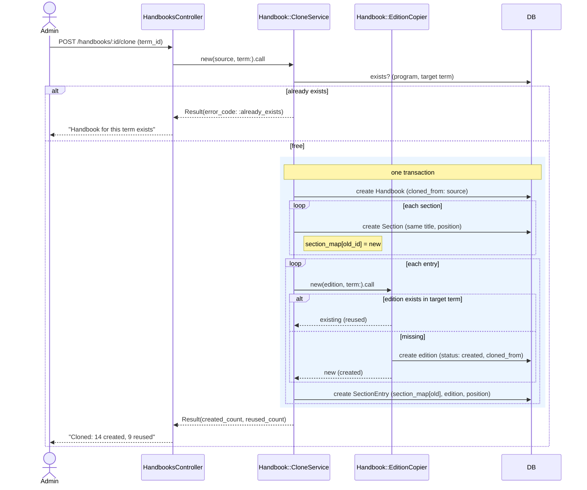

# Cloning

```admonish question "What is 'Cloning'?"
Cloning copies a handbook into a new term so the admin edits last term's structure instead of rebuilding it.

- **Common Examples:** "Copy Mathematik B.Sc. 100% from WS 2026/27 to WS 2027/28"
- **In this context:** A transactional service that copies structure (handbook, sections, entries) and finds or creates one module edition per module in the target term.
```

## Problem Overview

- Most of a handbook is unchanged between terms; rebuilding it by hand is slow and error‑prone.
- **Editions are shared** between handbooks of a term. Cloning Bachelor 100% and then Master 100% into the same term must not create the same edition twice, and must not overwrite an edition someone already reviewed.
- A half‑finished clone is worse than none.

## Solution Architecture

- **One service, one transaction:** `Handbook::CloneService#call`.
- **Id map for sections:** entries are placed through an `old section id → new section id` map, never by title or position lookups.
- **Find‑or‑create editions** via [`Handbook::EditionCopier`](03-module-editions.md#handbookeditioncopier-service-object): existing target‑term editions are reused untouched; missing ones are copied with `status: :created`.
- **Lineage:** `cloned_from_id` on the new handbook and on every newly created edition.
- **Report:** the result reports how many editions were created vs. reused, so the admin knows what still needs review.

```admonish tip "Glossary (Cloning)"
- **Source handbook:** the handbook being copied.
- **Target term:** the term of the new handbook.
- **Reused edition:** an edition that already existed in the target term (another handbook was cloned first).
- **Created edition:** a new copy of the source edition, status `created`.
```

---

## Handbook::CloneService (Service Object)
**_The Next‑Term Copier_**

```admonish info "What it represents"
Copies a handbook into a target term with all its sections and entries.
```

```admonish tip "Think of it as"
"Save as… next semester." The table of contents is copied; each page is either taken from the shelf (already exists this term) or photocopied from last term.
```

### Public Interface

| Method | Purpose |
|--------|---------|
| `initialize(source, term:)` | Source handbook and target term |
| `call` | Performs the clone; returns a `Result` |

| Result field | Description |
|--------------|-------------|
| `success?` | Whether the clone ran |
| `handbook` | The new handbook |
| `created_count` | Editions newly created |
| `reused_count` | Editions found in the target term |
| `error_code` | `:already_exists`, `:same_term` |

### Behavior Highlights

- Refuses if a handbook for (program, target term) already exists (`:already_exists`) or if the target term equals the source term (`:same_term`).
- Runs entirely inside `ActiveRecord::Base.transaction`; any failure rolls back everything.
- **Never overwrites** an existing edition, whatever its status.
- Copies section titles and positions exactly.
- Idempotent in effect: a second attempt is refused by the uniqueness guard rather than producing duplicates.

### Example Implementation

```ruby
module Handbook
  class CloneService
    Result = Struct.new(:success?, :handbook, :created_count, :reused_count,
                        :error_code, keyword_init: true)

    def initialize(source, term:)
      @source = source
      @term = term
    end

    def call
      return failure(:same_term) if @source.term_id == @term.id
      return failure(:already_exists) if target_exists?

      created = reused = 0
      handbook = nil

      ActiveRecord::Base.transaction do
        handbook = Handbook.create!(study_program: @source.study_program,
                                    term: @term,
                                    status: :draft,
                                    cloned_from: @source)

        section_map = {}
        @source.sections.each do |section|
          section_map[section.id] = handbook.sections.create!(
            title_de: section.title_de,
            title_en: section.title_en,
            position: section.position
          )
        end

        @source.sections.includes(section_entries: :module_edition).each do |section|
          section.section_entries.each do |entry|
            copy = EditionCopier.new(entry.module_edition, term: @term).call
            copy.created? ? created += 1 : reused += 1

            section_map.fetch(section.id).section_entries.create!(
              module_edition: copy.edition,
              position: entry.position
            )
          end
        end
      end

      Result.new(success?: true, handbook: handbook,
                 created_count: created, reused_count: reused)
    end

    private

    def target_exists?
      Handbook.exists?(study_program_id: @source.study_program_id, term: @term)
    end

    def failure(code)
      Result.new(success?: false, error_code: code)
    end
  end
end
```

## Sequence Diagram



### Usage Scenarios

- **First clone of a term:** WS 2026/27 Bachelor 100% → WS 2027/28. No WS 2027/28 editions exist; all 23 are created in status `created`.
- **Second clone, same term:** WS 2026/27 Master 100% → WS 2027/28. 9 of its modules are already in the Bachelor handbook; those 9 are reused (possibly already `checked`), 14 are created.
- **Retry:** the admin clicks clone twice; the second call returns `:already_exists`.

```admonish warning "Before migrating old data"
Cloning assumes one edition per (module, term). If imported legacy data has the same module with **different** text in two programs of the same term, the import must decide which text wins (or use `name_override`/separate catalog modules) before the unique index can be added. See [Integrity & Invariants](09-integrity-and-invariants.md).
```
