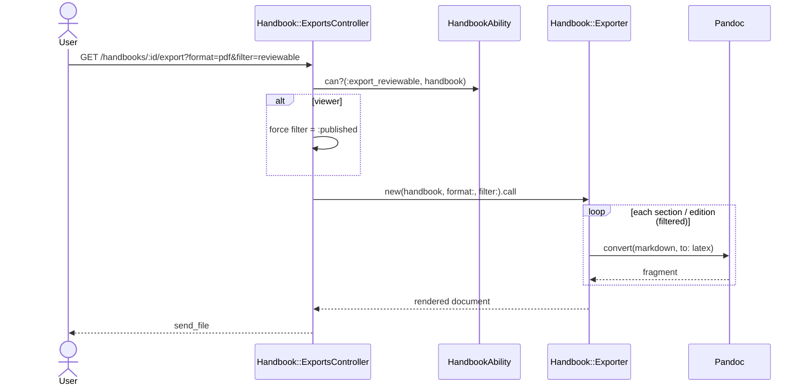

# Export

```admonish question "What is 'Export'?"
Export turns a handbook into a document others read.

- **Common Examples:** "Official PDF of Mathematik B.Sc. 100%, WS 2026/27", "Review PDF including checked modules"
- **In this context:** A service that walks a handbook in order, filters editions by status, converts Markdown content with pandoc, and fills a per‑format template.
```

## Problem Overview

- The current handbook is produced from LaTeX with a fixed style; the new export must match it closely enough for the admin to accept it.
- Typst is wanted as an alternative format; tables inside module content are a known pain point.
- Viewers must only ever see published content; admins also need a review version.
- The handbook may need to appear on another (Angular) page.

## Solution Architecture

- **Content stored as Markdown**, converted per format by **pandoc** (supports LaTeX, Typst and Markdown output, including tables).
- **Presentation only in templates**, one per format (`lib/templates/handbook/handbook.tex.erb`, `handbook.typ.erb`). Styling changes are template edits, not code changes.
- **Status filter** as an explicit parameter: `:published` (official) or `:reviewable` (checked + published).
- **LaTeX first** (matches the existing look), Typst and Markdown follow.

```admonish tip "Glossary (Export)"
- **Filter:** which edition statuses are printed (`:published`, `:reviewable`).
- **Template:** the format‑specific frame (title page, section headings, module layout).
- **Snapshot:** a stored copy of an official export (future, see [Future Extensions](10-future-extensions.md#export-snapshots)).
```

---

## Handbook::Exporter (Service Object)
**_The Typesetter_**

```admonish info "What it represents"
Renders one handbook into one output format with one status filter.
```

```admonish tip "Think of it as"
The print shop: it receives the table of contents and the approved pages, and prints them in the house style.
```

### Public Interface

| Method | Purpose |
|--------|---------|
| `initialize(handbook, format:, filter:)` | `format`: `:latex`, `:typst`, `:markdown`, `:pdf`; `filter`: `:published`, `:reviewable` |
| `call` | Returns the rendered document (string or file path for `:pdf`) |

### Behavior Highlights

- Order = section `position`, then entry `position`.
- Editions not matching the filter are skipped; empty sections are omitted.
- Viewers are forced to `filter: :published` by the controller (see [Roles & Permissions](08-roles-and-permissions.md)).
- Each Markdown field is converted separately with pandoc, then inserted into the template.

### Example Implementation

```ruby
module Handbook
  class Exporter
    FILTERS = {
      published: %w[published],
      reviewable: %w[checked published]
    }.freeze

    PANDOC_TARGET = { latex: "latex", typst: "typst", markdown: "gfm" }.freeze

    def initialize(handbook, format:, filter: :published)
      @handbook = handbook
      @format = format
      @statuses = FILTERS.fetch(filter)
    end

    def call
      ApplicationController.render(
        template: "handbook/exports/handbook",
        formats: [template_format],
        layout: false,
        assigns: { handbook: @handbook, sections: sections, convert: method(:convert) }
      )
    end

    private

    def sections
      @handbook.sections.includes(section_entries: { module_edition: :catalog_module })
               .map do |section|
        entries = section.section_entries.select { |e| @statuses.include?(e.module_edition.status) }
        [section, entries.map(&:module_edition)]
      end.reject { |_, editions| editions.empty? }
    end

    def convert(markdown)
      return "" if markdown.blank?
      PandocRuby.convert(markdown, from: :markdown, to: PANDOC_TARGET.fetch(@format))
    end

    def template_format
      { latex: :tex, typst: :typ, markdown: :md }.fetch(@format)
    end
  end
end
```

```admonish warning "Assumptions"
- Uses the `pandoc-ruby` gem; pandoc must be installed in the app container.
- `:pdf` (not shown) runs `latexmk` or `typst compile` on the rendered source in a temp dir. Run it in a background job if compile times exceed a few seconds.
- Template paths and the `.typ` format need registering as MIME types.
```

### Known Risks

| Risk | Mitigation |
|------|------------|
| Look differs from current PDF | Port the existing LaTeX preamble into the template first; get the current source |
| Tables in module content | pandoc emits tables for both formats; test one real module with a table early |
| Unexpected page breaks | Inspect the current source for manual break handling; reproduce in template |
| Special characters (`%`, `&`, `_`) | Never interpolate raw content into templates; always pass through `convert` |

---

## Export to Another Page

```admonish info "What it represents"
Showing the published handbook on an external (Angular) page.
```

| Approach | How | Fits when |
|----------|-----|-----------|
| Link to PDF | The other page links to the official PDF URL | Always works; simplest |
| HTML via `[innerHTML]` | Serve rendered HTML, injected by Angular | Only plain absolute links needed |
| JSON endpoint | `GET /handbooks/:id.json` (published only); the page renders itself | In‑app navigation or custom layout needed |

```admonish warning "Angular sanitizer"
Angular's sanitizer keeps plain `<a href="https://…">` links inside `[innerHTML]`, but strips `javascript:` URLs, inline event handlers, `<script>` and `style` attributes. `routerLink` and other Angular bindings do not work in injected HTML. If the page needs in‑app links, use the JSON endpoint.
```

## Sequence Diagram


