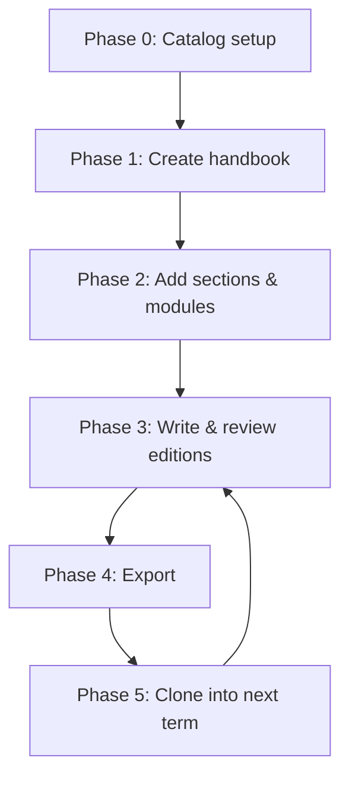

# End-to-End Workflow

This chapter follows one study program through two terms, from an empty catalog to a cloned, reviewed and exported handbook. Each phase only reads what earlier phases persisted.



---

## Phase 0: Catalog Setup

**Actor:** admin

1. Create study programs: *Mathematik B.Sc. 100%*, *Mathematik M.Sc. 100%*.
2. Create catalog modules: `MA101 Lineare Algebra I / Linear Algebra I`, `MA102 Analysis I / Analysis I`, …
3. Terms already exist in MaMpf.

**Persisted:** `handbook_study_programs`, `handbook_catalog_modules`.

```admonish note
Done once. Afterwards only new modules or programs are added.
```

---

## Phase 1: Create Handbook

**Actor:** admin

1. Pick *Mathematik B.Sc. 100%* + *WS 2026/27* → `Handbook::Handbook` (status `draft`).
2. A second handbook for the same pair is refused (unique index).

**Persisted:** `handbook_handbooks`.

---

## Phase 2: Add Sections & Modules

**Actor:** admin

1. Add sections: *Pflichtmodule* (position 1), *Wahlpflichtmodule* (position 2).
2. In *Pflichtmodule*, add `MA101`:
   - No WS 2026/27 edition exists → create one (empty, or copied from an earlier term via `EditionCopier`).
   - `SectionEntry` (section, edition, position 1).
3. Later, the Master handbook adds `MA101` too → the existing WS 2026/27 edition is linked, not duplicated.

**Persisted:** `handbook_sections`, `handbook_section_entries`, `handbook_module_editions`.

---

## Phase 3: Write & Review Editions

**Actor:** admin

1. Fill content (Markdown), language, ECTS for each edition.
2. Review: `check!` → `publish!`.
3. Any content edit on a checked/published edition resets it to `created`.
4. The handbook page shows progress: *12 published, 3 checked, 2 created*.

**Persisted:** edition fields and `status`.

---

## Phase 4: Export

**Actor:** admin (review), viewer (official)

1. Admin exports with `filter: :reviewable` to proofread.
2. When satisfied, admin sets the handbook to `published`.
3. Viewers export with `filter: :published` (forced).

**Persisted:** nothing (snapshots are a [future extension](10-future-extensions.md#export-snapshots)).

---

## Phase 5: Clone into Next Term

**Actor:** admin

1. Clone *B.Sc. 100%, WS 2026/27* → *WS 2027/28*: all editions created in status `created`, `cloned_from` set.
2. Clone *M.Sc. 100%, WS 2026/27* → *WS 2027/28*: shared modules reused, the rest created.
3. Edit what changed (e.g., `MA101` now taught in English → `language: :en`, displayed as "Linear Algebra I").
4. Continue with Phase 3.

**Persisted:** new handbook, sections, entries, created editions; summary shown to the admin.

---
