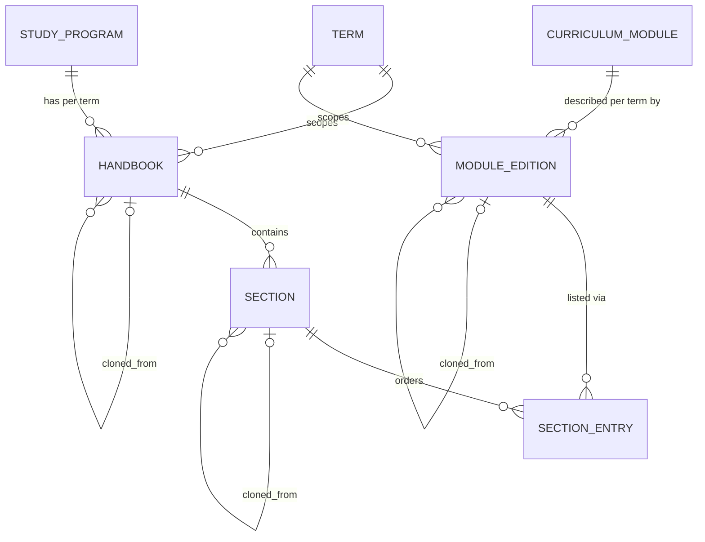

# Domain Model

This chapter summarizes the principal entities; behavioral details live in the referenced chapters.

## Base Data

| Component | Type | Description |
|-----------|------|-------------|
| `Handbook::StudyProgram` | ActiveRecord | Study program variant incl. PO version (e.g., "Informatik BSc 100%", "Informatik BSc 100% alt"); default language, expire date |
| `Handbook::CurriculumModule` | ActiveRecord | Admin‑verified, term‑independent module identity: code, internal title, subject area, notes, active |
| `Term` | ActiveRecord (MaMpf, reused) | Semester (e.g., WS 2026/27) |

## Module Editions

| Component | Type | Description |
|-----------|------|-------------|
| `Handbook::ModuleEdition` | ActiveRecord | One `CurriculumModule` in one `Term`: language, printed name, ECTS, text fields, status (created/checked/published) |
| `Handbook::EditionCopier` | Service | Finds or builds the `ModuleEdition` for a target term from a source one (content copy, status reset, lineage) |

## Handbooks

| Component | Type | Description |
|-----------|------|-------------|
| `Handbook::Handbook` | ActiveRecord | One `StudyProgram` in one `Term`: language, front matter (title, intro incl. Studienverlaufspläne), ordered sections, status (draft/published) |
| `Handbook::Section` | ActiveRecord | Ordered, titled group inside one `Handbook`, with optional intro / outro |
| `Handbook::SectionEntry` | ActiveRecord | Ordered link (`Section`, `ModuleEdition`); a `ModuleEdition` appears at most once per `Handbook` |

## Cloning, Export, Access

| Component | Type | Description |
|-----------|------|-------------|
| `Handbook::CloneService` | Service | Copies a `Handbook` into a target term; find‑or‑create `ModuleEdition`s. "Prepare a term" runs it for many programs at once |
| `Handbook::Exporter` | Service | Renders a `Handbook` (draft = all, official = published only) through a template; also single `ModuleEdition`s |
| `HandbookAbility` | Ability (CanCanCan) | admin, viewer, public (published only); lecturer later |
| History | TBD (e.g., versions table) | Who changed what and when, on all models above. **TODO: decide** |

## Old System → New

| Old | New | Note |
|-----|-----|------|
| Code | `CurriculumModule` | |
| Fachgebiet | enum `subject_area` on `CurriculumModule` | 3 fixed values (Mathematik, Informatik, Allgemeine Module); no admin‑managed table needed |
| Modulhandbuch | `StudyProgram` | Term‑independent, like the old one |
| Semester | `Term` (MaMpf) | Start / Ende not needed |
| Modul | `ModuleEdition` | One language instead of DE/EN pairs |
| Gruppierung | `Section` | ⚑ `heading_level` open |
| Zusammenstellung | `SectionEntry` | |
| Latex Elemente / Layout | `Handbook` front matter + export template | Header / Footer → template; Intro → `title`, `subtitle`, `issue_date`, `intro` |
| Course Cycle | text field `cycle` on `ModuleEdition` | Old values: other, SS, WS, WS/SS. A `ModuleEdition` already has the Turnus text ("every winter semester"); a 4‑value table adds nothing |
| Course Source | derived, no table | Old values: 01 Admin, 02 Semester‑Copy, 03 erstellt durch Dozent, 04 geändert durch Dozent, 05 Test. Semester‑Copy = `cloned_from` set and not edited since; Admin / Dozent = who edited last (**needs History**); Test = not migrated |
| LSF‑Sortierung + LSF fields | — | **TODO: verify if still needed (LSF replaced by heiCO since SoSe 2024). Do not implement.** |
| Abfragen | — | Dropped; filters + CSV export instead |
| Git Export | Export snapshots | [Future extension](09-future-extensions.md) |

## Linking Concepts

```admonish info "What are linking concepts?"
These are the points where the handbook touches existing MaMpf models. The handbook is deliberately loosely coupled: it reuses `Term` and `User`, and nothing else.
```

| Domain Model | Links To | Via | Purpose |
|--------------|----------|-----|---------|
| `Term` | `ModuleEdition` | `belongs_to :term` | Scope a `ModuleEdition` to a semester |
| `Term` | `Handbook` | `belongs_to :term` | Scope a `Handbook` to a semester |
| `User` | Permissions | `HandbookAbility` | admin / viewer (lecturer later) |
| `User` | `ModuleEdition` | `responsible_user_id` (nullable) | Lecturer role later |
| `Lecture` | `ModuleEdition` | none (future, optional) | Link a `ModuleEdition` to the lecture that teaches it |

**Example Flows:**

1. **Build a handbook:** `StudyProgram` + `Term` → `Handbook` (front matter) → `Section`s → `SectionEntry` linking a `ModuleEdition` (found or created for `CurriculumModule` + `Term`)
2. **Publish:** `ModuleEdition` status created / checked / published (manual flag, set by whoever edits); `Handbook` draft → published
3. **Next term:** "Prepare a term" runs `CloneService` per program: copies `Handbook` + `Section`s, finds or creates `ModuleEdition`s in the target term, rebuilds `SectionEntry`s
4. **Export:** `Exporter` walks front matter → sections → entries → `ModuleEdition`s in order, filters by status, fills the template

## High-Level ERD (Simplified)



```admonish note "One ModuleEdition, many Handbooks"
A `ModuleEdition` is shared by every `Handbook` of its term that lists it (e.g., Informatik BSc 100% and BSc 50% both list *IAD, WS 2026/27*). Editing it changes all of them. This is intended and is the reason cloning uses find‑or‑create (see [Cloning](16-cloning.md)).
```

See details:

- [Base Data](02-base-data.md)
- [Module Editions](03-module-editions.md)
- [Handbooks](04-handbooks.md)
- [Cloning](16-cloning.md)
- [Export](17-export.md)
- [Integrity & Invariants](08-integrity-and-invariants.md)