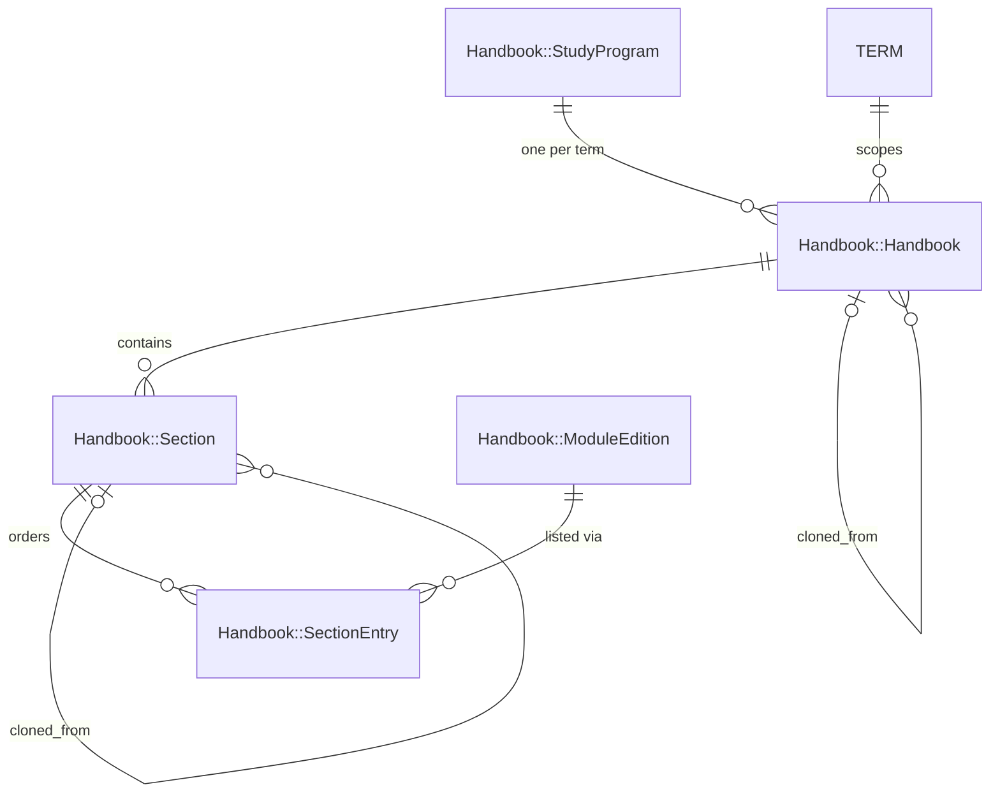

# Handbooks

```admonish question "What is a 'Handbook'?"
A `Handbook` is the ordered list of modules a `StudyProgram` offers in a `Term`.

- **Common Examples:** "Modulhandbuch Informatik BSc 100%, WS 2026/27"
- **In this context:** A container of ordered `Section`s, each holding ordered references to `ModuleEdition`s, plus the handbook's own front matter. It never holds module content.
```

| Model | Old system |
|-------|------------|
| `Handbook::Handbook` | (Modulhandbuch, Semester): implicit, plus Latex Elemente (Header / Intro / Footer) |
| `Handbook::Section` | Gruppierung (Modulhandbuch → GruppierungListe / Edit) |
| `Handbook::SectionEntry` | Zusammenstellung (Modulhandbuch → ZusammenstellungListe) |

## Problem Overview

- Each `StudyProgram` publishes its own handbook per term, grouped into sections (e.g., "Pflichtmodule Informatik", "Wahlmodule Informatik", "Anwendungsgebiet").
- The same `ModuleEdition` can sit in several `Handbook`s of the same term.
- A module offered for program K in term X may be missing for K in term Y; this must be expressible without flags on the module.
- Each handbook has its own front matter (title page, Präambel, Studienverlaufspläne) and text around sections (intro before the modules, closing text after). The old system stores these as raw LaTeX per (Modulhandbuch, Semester).

## Solution Architecture

- **`Handbook` = (`StudyProgram`, `Term`)**, unique. One `StudyProgram` per `Handbook`; the old system never combines programs (BSc 100% and BSc 50% are separate Modulhandbücher).
- **One language per `Handbook`**, default from `StudyProgram#default_language`. It applies to the handbook's own text (front matter, section titles, field labels). `ModuleEdition` text is printed in the `ModuleEdition`'s language.
- **Front matter as text fields on `Handbook`** (Markdown formatting), not raw LaTeX. Preamble and layout live in the export template (see [Export](17-export.md)).
- **`Section`s belong to exactly one `Handbook`**; reuse across handbooks is not worth the coupling.
- **Membership only through `SectionEntry`**: no direct `Handbook` ↔ `ModuleEdition` link, so there is one source of truth. "Module belongs to K in X but not in Y" falls out of which entries exist.
- **Ordering via `position`** on `Section`s and `SectionEntry`s. Replaces the old sort by `Kurz` prefix ("01 …", "02 …").

```admonish tip "Glossary (Handbooks)"
- **Handbook:** program + term + front matter + ordered sections.
- **Section:** titled group inside a handbook, with optional intro / outro.
- **Entry:** one `ModuleEdition` placed in a section at a position.
```

---

## Handbook::Handbook (ActiveRecord Model)
**_The Document_**

```admonish info "What it represents"
The module handbook of one `StudyProgram` for one `Term`.
```

```admonish tip "Think of it as"
The printed PDF without the module pages: cover, Präambel, table of contents, Studienverlaufspläne, section headings. Module pages (`ModuleEdition`s) are shared with other handbooks of the same term.
```

| Name/Field | Type/Kind | Description |
|------------|-----------|-------------|
| `study_program_id` | DB column | Foreign key to `Handbook::StudyProgram` |
| `term_id` | DB column | Foreign key to MaMpf `Term` |
| `language` | DB column (Enum) | `de`, `en`; default from the `StudyProgram` |
| `title` | DB column | Cover title (default "Modulhandbuch <program name>") |
| `subtitle` | DB column, nullable | Cover subtitle (e.g., PO version and date) |
| `issue_date` | DB column, nullable | Date on the cover (old: "Das Datum muss noch aktualisiert werden!") |
| `intro` | DB column (Markdown) | Text before the first section: Präambel, Studienverlaufspläne |
| `outro` | DB column (Markdown), nullable | Text after the last section |
| `status` | DB column (Enum) | `draft`, `published` |
| `published_at` | DB column, nullable | Set on publish |
| `cloned_from_id` | DB column, nullable | Source `Handbook` |
| `sections` | Association | Ordered `Section`s |
| `module_editions` | Association | All `ModuleEdition`s, through sections and entries |
| `status_counts` | Method | `{ created: n, checked: n, published: n }` over its `ModuleEdition`s |

### Behavior Highlights

- Unique on (`study_program_id`, `term_id`).
- Destroying a `Handbook` destroys its `Section`s and `SectionEntry`s, **never** the `ModuleEdition`s.
- A `published` `Handbook` cannot be destroyed; unpublish it first.
- `Handbook` status and `ModuleEdition` status are independent: publishing the `Handbook` makes it visible to read‑only users and the public; which `ModuleEdition`s are printed is decided by the export filter (see [Export](17-export.md)).
- Cloning copies `language`, `title`, `subtitle`, `intro`, `outro`; resets `issue_date`, `status: :draft`, `published_at`.
- Studienverlaufspläne are part of `intro` (text + simple table). Old `\pageref` references become links to the heading.

---

## Handbook::Section (ActiveRecord Model)
**_A Chapter of the Handbook_**

```admonish info "What it represents"
A titled, ordered group of `ModuleEdition`s inside one `Handbook`.
```

```admonish tip "Think of it as"
A heading in the PDF with its intro text: "Pflichtmodule Informatik", "Wahlmodule Informatik".
```

| Name/Field | Type/Kind | Description |
|------------|-----------|-------------|
| `handbook_id` | DB column | Foreign key to the `Handbook` |
| `title` | DB column, nullable | Heading, in the `Handbook`'s language; empty = no heading |
| `heading_level` | DB column (Enum) | `chapter`, `section` (old "Überschrift in Tex als") |
| `intro` | DB column (Markdown), nullable | Text before the modules (old Latex Intro) |
| `outro` | DB column (Markdown), nullable | Text after the modules (old Latex Extro) |
| `position` | DB column | Order within the `Handbook` |
| `cloned_from_id` | DB column, nullable | Same `Section` in the source `Handbook` (old Vorsemester Gruppierung) |
| `section_entries` | Association | Ordered `SectionEntry`s |

### Behavior Highlights

- One `title`, not DE/EN: a `Section` belongs to one `Handbook`, which has one language.
- Old trick "intro of section 2 contains the chapter *Wahlbereich*" becomes its own `Section` with `heading_level: chapter` and no entries.
- Deleting a `Section` with entries asks first; it removes the entries, never the `ModuleEdition`s. (Old system blocked delete while non‑empty.)
- ⚑ Open: `heading_level` (flat list, chapter/section) vs. chapter headings written inside an intro (old way). This chapter assumes `heading_level`.

---

## Handbook::SectionEntry (ActiveRecord Model)
**_A Module's Place in a Section_**

```admonish info "What it represents"
The placement of one `ModuleEdition` at a position in one `Section`.
```

```admonish tip "Think of it as"
- **Library Analogy:** A reading list entry pointing at a book; many reading lists can point at the same book.
- **Comparison:** Plays the role `Registration::Item` plays for registerables: a listing, not the thing itself.
```

| Name/Field | Type/Kind | Description |
|------------|-----------|-------------|
| `section_id` | DB column | Foreign key to the `Section` |
| `module_edition_id` | DB column | Foreign key to the `ModuleEdition` |
| `position` | DB column | Order within the `Section` |

### Behavior Highlights

- A `ModuleEdition` appears at most once per `Handbook` (not only per `Section`).
- **Term guard:** the `ModuleEdition`'s term must equal the `Handbook`'s term.
- Removing an entry never deletes the `ModuleEdition`.


### Usage Scenarios

- **Add a module with an existing `ModuleEdition`:** searching *IAD* in *Informatik BSc 50%, WS 2026/27*: the WS 2026/27 `ModuleEdition` exists (added by BSc 100%), so an entry is created pointing at it.
- **Add a module without a `ModuleEdition`:** none exists for this term; the UI offers "empty" or "copy from previous term" ([EditionCopier](03-module-editions.md#handbookeditioncopier-service-object)), then creates the entry.
- **Move a module:** the entry changes `section_id` and `position`; the `ModuleEdition` is untouched.

---

## ERD



---

## Not Migrated

| Old | Why |
|-----|-----|
| Latex Elemente `Header` / `Footer` | Preamble and `\end{document}` live in the export template |
| Latex Elemente `Intro` as raw LaTeX | Split into `title`, `subtitle`, `issue_date`, `intro` (Markdown) |
| Latex Layout | Same records as Latex Elemente in the old system |
| Gruppierung `Kurz DE/EN` | Only used for sorting; replaced by `position` |
| Gruppierung `Name EN` / `Kurz EN` | One `title` in the `Handbook`'s language |
| Gruppierung `Info` | Internal note about the LaTeX; not needed with Markdown |

---

## Database Tables

- `handbook_handbooks` - One per (`StudyProgram`, `Term`), with front matter
- `handbook_sections` - Ordered sections of a `Handbook`
- `handbook_section_entries` - Ordered (`Section`, `ModuleEdition`) placements