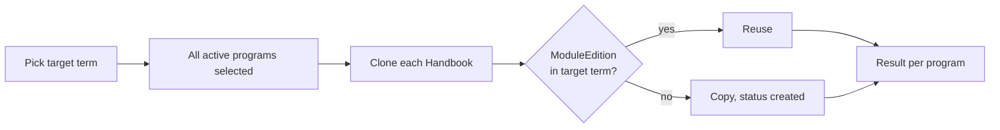

# Cloning

Before a new term, the admin copies last term's handbooks into it, so only the changes need editing.

**Example:** SoSe 2026 has 160 module descriptions in 16 Modulhandbücher. Before WS 2026/27, the admin copies SoSe 2026 → WS 2026/27. Every handbook gets the same sections, module lists and front matter. The module descriptions are copies, ready to be updated and reviewed.

| | Old | New |
|---|---|---|
| Screen | Course → Semester, StudDekanin → SemesterList: `copy to next Semester` on a semester row | Handbooks list → **Prepare a term…** (all programs); **⋯ → Clone to another term** (one handbook); **New handbook → clone from** |
| Permission | Course, StudDekan tabs | **admin** |

---

## Old System: What the Staff Does

1. Open the Semester list.
2. On the current semester (e.g., SoSe 2026), click **copy to next Semester**.
3. Everything is copied to the next semester (WS 2026/27): all modules, all Gruppierungen + Zusammenstellung, all Latex Elemente, for every Modulhandbuch (confirmed by staff).
4. Copied modules are marked Course Source "02 Semester‑Copy". Then the staff updates what changed.

---

## New: Prepare a Term

1. Handbooks list → **Prepare a term…**
2. Pick the **target term** (e.g., WS 2026/27; must exist in MaMpf). The source defaults to the latest term with handbooks (SoSe 2026).
3. Summary: "Clone 12 programs from SoSe 2026 → WS 2026/27". All active programs are selected; the list is collapsed.
4. **Prepare** → every program is cloned.
5. Result per program: **"Informatik BSc 50%: 4 created · 12 reused · 1 skipped (inactive)"**.

Unticking programs is possible, but not the normal flow.



**Single handbook:** Handbooks list → **⋯ → Clone to another term**, or **New handbook → clone from**. Same rules, one program.

---

## Rules

- **Copied:**
  - `Handbook`: `language`, `title`, `subtitle`, `intro`, `outro`
  - `Section`s: title, heading level, intro, outro, order
  - `SectionEntry`s: order
- **Reset:** `Handbook` status → `draft`; `issue_date`, `published_at` cleared.
- **`ModuleEdition`s are found or created** in the target term:
  - exists already (another program was cloned first) → **reused untouched**, whatever its status
  - missing → **copied** from the source, status `created`
- **Lineage:** `cloned_from` on the new `Handbook`, each `Section`, each created `ModuleEdition` (used by "Compare with previous term").
- **All or nothing** per `Handbook`.
- **Refused when:** a `Handbook` for (program, target term) exists, or target term = source term.
- **Not copied:** expired `StudyProgram`s; inactive `CurriculumModule`s (listed as skipped).

---

## Usage Scenarios

- **Prepare WS 2026/27:** all active programs cloned from SoSe 2026. IAD is in BSc 100% and BSc 50%: created once, reused for the second.
- **New program:** Mathematik MSc MLDS has no SoSe 2026 handbook → not in the list; the admin creates it with **New handbook**.
- **Retry:** Prepare WS 2026/27 again → every program is refused, the `Handbook`s exist.

---

## Differences to the Old System

| Old | New |
|-----|-----|
| Pick the **source** semester; always copies to the next one | Pick the **target** term; source preselected |
| Copies all programs, incl. expired ones | Copies active programs only |
| Copies all modules, incl. ones in no handbook | Copies only `ModuleEdition`s a cloned `Handbook` lists |
| Copies marked Course Source "02 Semester‑Copy" | `cloned_from` set, status `created` |
| Gruppierung linked by "Vorsemester Gruppierung" | `Section#cloned_from` |

```admonish question "Ask the staff"
- Have you ever needed to copy only some programs, or always all?
- Are modules in no handbook ever needed in the next term?
- Are copied modules released or unreleased afterwards?
```

---

## Implementation Notes

- **Services:** `Handbook::CloneService` clones one `Handbook`; it uses `Handbook::EditionCopier` per entry. "Prepare a term" calls `CloneService` once per selected program.
- **Transaction:** one per `Handbook` clone. In "Prepare a term", one failure does not stop the others; the result lists failed programs.
- **Section mapping:** entries are placed through an `old section id → new section id` map, never by title or position.
- **Duplicates:** unique indexes on `ModuleEdition (curriculum_module_id, term_id)` and `Handbook (study_program_id, term_id)`. If two admins clone at once, `EditionCopier` rescues the unique‑index error and returns the existing `ModuleEdition` as reused.
- **Result:** per program `created`, `reused`, `skipped`, or an error (`already_exists`, `same_term`).