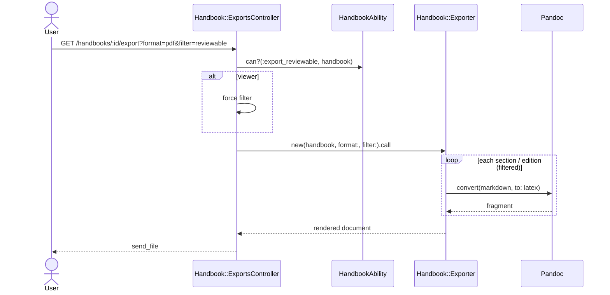

# Export

```admonish question "What is 'Export'?"
Export turns a handbook into a document others read.

- **Common Examples:** "Official PDF of Mathematik B.Sc. 100%, WS 2026/27", "Review PDF including checked modules"
- **In this context:** A service that walks a handbook in order, filters editions by status, converts Markdown content with pandoc, and fills a per‑format template.
```

## Requirement

- Support 2 format: LaTeX + Typst
- There are possibility to export based on Module Editions status published or checked status
- The handbook may need to appear on another page (Future extension)

## Solution Architecture

- **Content stored as Markdown**, converted per format by **pandoc** (supports LaTeX, Typst and Markdown output, including tables).
- **Presentation only in templates**, one per format (`lib/templates/handbook/handbook.tex.erb`, `handbook.typ.erb`). Styling changes are template choices.
- **Status filter** as an explicit parameter: TODO (check against current system)
- **LaTeX first** (matches the existing look), Typst follow.
- **Template is uploadable by admin** (Future extension)


---

## Handbook::Exporter (Service Object)
**_The Typesetter_**

```admonish info "What it represents"
Renders one handbook into one output format with one status filter.
```

### Public Interface

| Method | Purpose |
|--------|---------|
| `initialize(handbook, format:, filter:)` | `format`: `:latex`, `:typst`, `:markdown`, `:pdf`; `filter`: TODO (check against current system) |
| `call` | Returns the rendered document (string or file path for `:pdf`) TODO: decide on this |

### Behavior Highlights

- Order: section `position` and entry `position`.
- Editions not matching the filter are skipped; empty sections are omitted.
- Each Markdown field is converted separately with pandoc, then inserted into the template.

### Example Implementation
Suggested by Claude, not verified

```ruby
module Handbook
  class Exporter
    FILTERS = {
      published: %w[published],
      reviewable: %w[checked published]
    }.freeze

    PANDOC_TARGET = { latex: "latex", typst: "typst", markdown: "gfm" }.freeze

    def initialize(handbook, format:, filter: :published)
      @handbook = handbook
      @format = format
      @statuses = FILTERS.fetch(filter)
    end

    def call
      ApplicationController.render(
        template: "handbook/exports/handbook",
        formats: [template_format],
        layout: false,
        assigns: { handbook: @handbook, sections: sections, convert: method(:convert) }
      )
    end

    private

    def sections
      @handbook.sections.includes(section_entries: { module_edition: :catalog_module })
               .map do |section|
        entries = section.section_entries.select { |e| @statuses.include?(e.module_edition.status) }
        [section, entries.map(&:module_edition)]
      end.reject { |_, editions| editions.empty? }
    end

    def convert(markdown)
      return "" if markdown.blank?
      PandocRuby.convert(markdown, from: :markdown, to: PANDOC_TARGET.fetch(@format))
    end

    def template_format
      { latex: :tex, typst: :typ, markdown: :md }.fetch(@format)
    end
  end
end
```

```admonish warning "Assumptions"
- Uses the `pandoc-ruby` gem; pandoc must be installed in the app container.
- Background job consideration
- MIME types for response types
```

### Known Risks

| Risk | Mitigation |
|------|------------|
| Look differs from current PDF | Port the existing LaTeX preamble into the template first; get the current source |
| Tables in module content | pandoc emits tables for both formats; test one real module with a table early |
| Unexpected page breaks | Inspect the current source for manual break handling; reproduce in template |
| Special characters (`%`, `&`, `_`) | Never interpolate raw content into templates; always pass through `convert` |

---

## Export to Another Page (Future extension)

```admonish info "What it represents"
Showing the published handbook on an external page.
```
TODO:

I need to see the page first :))

## Sequence Diagram


