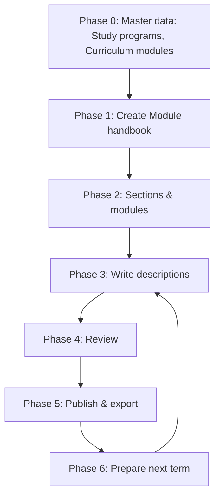
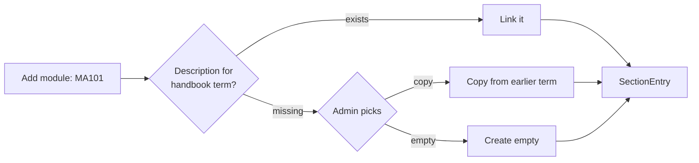
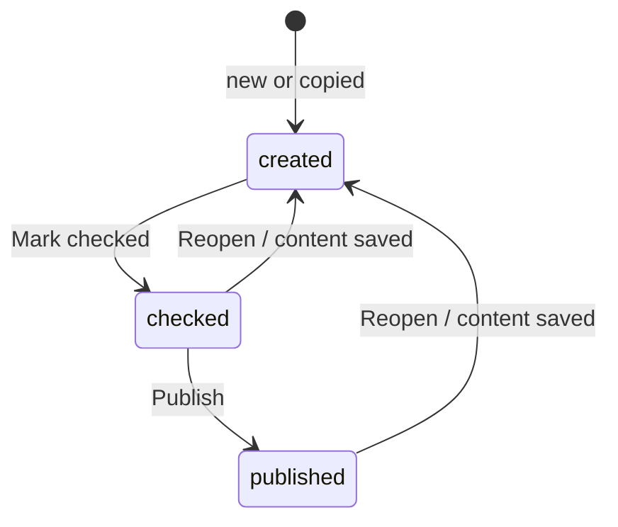

# End-to-End Workflow

This chapter follows the Mathematics handbooks through two terms: from empty master data to reviewed, published and exported handbooks, then into the next term. Each phase only reads what earlier phases persisted. Screens are described in [UI Design](handbook-ui-design.md).



```admonish tip "The one rule behind this flow"
The admin works with **handbooks** and **curriculum modules**. A module description (`ModuleEdition`) is never created on its own: it is found or created when a module is added to a handbook, for the handbook's term. Everything below follows from that.
```

---

## Phase 0: Master Data

**Actor:** admin · **Screen:** Master data (tabs: Study programs, Curriculum modules)

1. Create Study programs: *Mathematik B.Sc. 100%*, *Mathematik B.Sc. 50%*, *Mathematik M.Sc. 100%*.
2. Create Curriculum modules: `MA101 Lineare Algebra I / Linear Algebra I`, `MA102 Analysis I / Analysis I`, …
3. Terms already exist in MaMpf.

**Rules:**

- Curriculum modules codes are unique.
- Delete is blocked while in use
- Editing a module or program that is in use warns that the **change applies to every term**, including published handbooks.

**Persisted:** `handbook_study_programs`, `handbook_curriculum_modules`.

```admonish note
Done once. Afterwards only new modules or programs are added.
```

---

## Phase 1: Create Handbook

**Actor:** admin · **Screen:** Handbooks list → *New handbook*

1. Pick *Mathematik B.Sc. 100%* + *WS 2026/27*.
2. Choose **start empty** (first term for this program) or **clone from an earlier term** (see Phase 6).
3. Result: `Handbook::Handbook` in status `draft`; the editor opens.

**Rules:** one handbook per (study program, term). The form says so before submitting if one exists.

**Persisted:** `handbook_handbooks`.

---

## Phase 2: Sections & Modules

**Actor:** admin · **Screen:** Handbook editor

1. Add sections: *Pflichtmodule*, *Wahlpflichtmodule*, *Seminare* (TODO: recheck with current system). Rename and reorder as needed.
2. In *...module*, click **Add module** and search `MA101`. The result shows its state for WS 2026/27 before anything is added:

| State for the handbook's term | Admin sees | What happens |
|-------------------------------|------------|--------------|
| Description exists | "Description exists · shared with …" → **Add** | Entry links the existing description |
| No description, earlier term has one | **Copy from WS 2025/26** / **Empty** | `EditionCopier` copies it (status `created`, `cloned_from` set), or an empty one is created; then the entry |
| No description, never had one | **Add empty** | Empty description created, then the entry |
| Already in this handbook | Disabled, names the section | Nothing |

3. Later, the *B.Sc. 50%* handbook adds `MA101` too. The WS 2026/27 description already exists, so it is **linked, not duplicated**. Both handbooks now show a `🔗 2 handbooks` badge on that row.
4. Reorder entries, move them between sections, or remove them. Removing says *"Removes it from B.Sc. 100% only; B.Sc. 50% keeps the description."*



**Persisted:** `handbook_sections`, `handbook_section_entries`, `handbook_module_editions` (only when created).

---

## Phase 3: Write Descriptions

**Actor:** admin · **Screens:** description side panel (from the handbook editor) or description edit page (from the descriptions list)

1. Fill language of instruction, ECTS and the Markdown fields (content, prerequisites, exam form, workload).
2. The displayed name follows the language: `MA101` with `language: :en` shows as *Linear Algebra I*. An optional name override covers odd cases.
3. A shared description shows a banner: *"Used in 2 handbooks: B.Sc. 100%, B.Sc. 50%. Changes apply to both."*
4. **Compare with previous term** shows a word diff per field against the description it was copied from, so only changes need reading. If the language changed, the previous text is shown instead of a diff.

**Persisted:** edition fields.

---

## Phase 4: Review

**Actor:** admin · **Screen:** Module descriptions list (filtered by term and status)

1. Filter *WS 2026/27 · Created*. The status filter shows counts per status, so the admin sees what is left.
2. Open a description, read it (with compare on), step to the next one with **‹ ›** without going back to the list.
3. Select the reviewed rows → **Mark checked**. Later, *Checked* → **Publish**. Bulk actions skip rows in the wrong status and warn when shared descriptions are included.



**Rules:**

- Status belongs to the description, so it is the same in every handbook that uses it.
- Saving content of a checked or published description resets it to `created`. The save asks first and names every affected handbook.
- Status actions are disabled while there are unsaved changes.

**Persisted:** `status` on `handbook_module_editions`.

---

## Phase 5: Publish & Export

**Actor:** admin (review and publish), viewer (official PDF) · **Screens:** Handbook editor, Handbooks list

1. Admin exports a **review PDF** (checked + published) to proofread the whole handbook.
2. Admin clicks **Publish handbook**. If some descriptions are not published yet, the dialog lists them: they will not appear in the official PDF until published.
3. Viewers get the **official PDF** (published descriptions only). The controller forces this filter for viewers.

**Rules:** a published handbook cannot be deleted; unpublish it first.

**Persisted:** handbook `status`. Exports are generated on demand (snapshots are a [future extension](10-future-extensions.md#export-snapshots)).

---

## Phase 6: Prepare the Next Term

**Actor:** admin · **Screen:** Handbooks list → *Prepare a term…*

1. Pick the target term *WS 2027/28*. The dialog lists every program that had a handbook before but has none in WS 2027/28, each with its latest source term.
2. Clone the selected ones in one go. For each handbook, `CloneService` copies sections and order, and for each module finds or creates the WS 2027/28 description:
   - *B.Sc. 100%* goes first: all its descriptions are created (status `created`, `cloned_from` set).
   - *B.Sc. 50%* next: modules it shares with B.Sc. 100% are **reused**, the rest created.
3. The summary shows created vs. reused per handbook: *"B.Sc. 50%: 4 created · 12 reused"*.
4. Edit what changed (e.g., `MA101` is now taught in English → set `language: :en`), then continue with Phase 3.

A single handbook can also be cloned from the list (*⋯ → Clone to another term*) or created by cloning in *New handbook*.

**Persisted:** new handbooks, sections, entries; new descriptions only where none existed in the target term.

---

## Cleaning Up

A description removed from its last handbook is not deleted automatically. It shows as **Not in any handbook** in the descriptions list and can be added again or deleted there. Deleting a description that any handbook still uses is blocked.

---

## Data at Each Phase

| Phase | Reads | Writes |
|-------|-------|--------|
| 0 Master data | – | StudyProgram, CurriculumModule |
| 1 Create handbook | StudyProgram, Term | Handbook |
| 2 Sections & modules | Handbook, CurriculumModule, ModuleEdition | Section, SectionEntry, ModuleEdition (find‑or‑create) |
| 3 Write | ModuleEdition, previous‑term ModuleEdition | ModuleEdition (content) |
| 4 Review | ModuleEdition | ModuleEdition (status) |
| 5 Publish & export | Handbook → Section → Entry → Edition | Handbook (status) |
| 6 Prepare next term | Source handbooks, target‑term editions | Handbook, Section, SectionEntry, ModuleEdition |